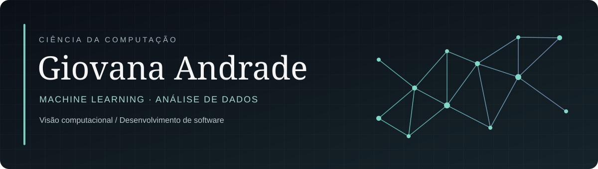

**Machine Learning · Visão Computacional · Análise de Dados · Desenvolvimento de Software**

Estudo Ciência da Computação e compartilho por aqui projetos, experimentos e o que venho aprendendo, especialmente em Machine Learning, visão computacional e análise de dados.

[Portfólio](https://giovana-portifolio.framer.website/) · [LinkedIn](https://www.linkedin.com/in/giovanaandradef/) · [E-mail](mailto:giovanaandrade2410@gmail.com)

---

### Tecnologias

### Projetos em destaque

| Projeto | Sobre |
| --- | --- |
| [**KNN Syndrome Classification**](https://github.com/GiovanaAndrade1/Test_apollo_solutions) | Classificação de síndromes com KNN, comparação entre distâncias Euclidiana e Cosseno, validação cruzada e avaliação com AUC, F1-Macro e Top-k Accuracy. |
| [**chess_web**](https://github.com/GiovanaAndrade1/chess_web) | Projeto de aplicação web para gerenciamento de torneios de xadrez. |
| [**GlaucomaDataset**](https://github.com/glaucoma-cnn/GlaucomaDataset) | Projeto colaborativo de análise de imagens retinianas. A etapa atual explora máscaras de disco e copo óptico, extrai medidas morfológicas e gera relatórios; parte de uma iniciativa de pesquisa em glaucoma. |
| [**hash**](https://github.com/GiovanaAndrade1/hash) | Repositório de estudos e implementação relacionados a hash. |

> Novos projetos de Machine Learning, análise de dados e desenvolvimento serão adicionados conforme forem ficando prontos.

---

[Conheça meu portfólio](https://giovana-portifolio.framer.website/) · [Vamos conversar](mailto:giovanaandrade2410@gmail.com)

